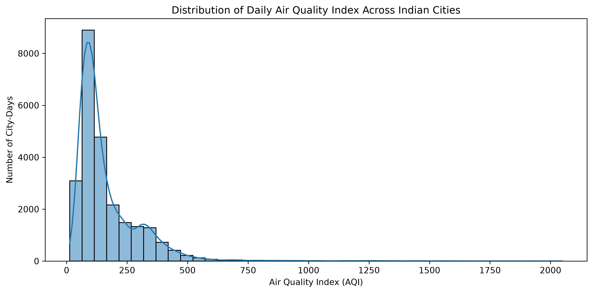
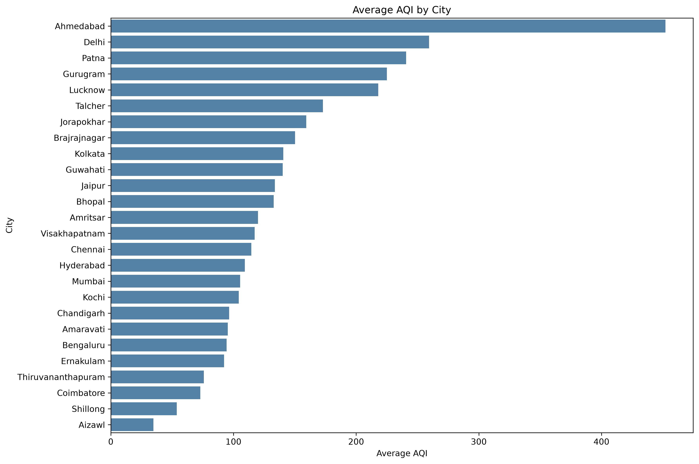
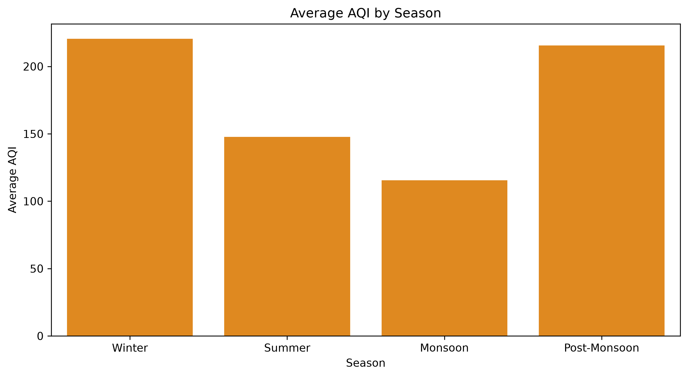
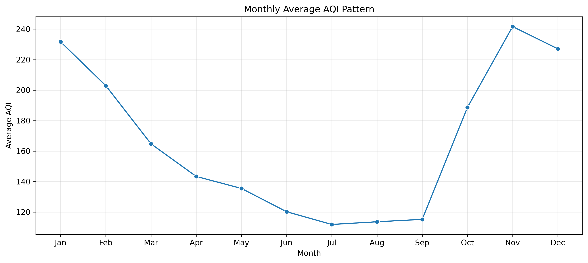
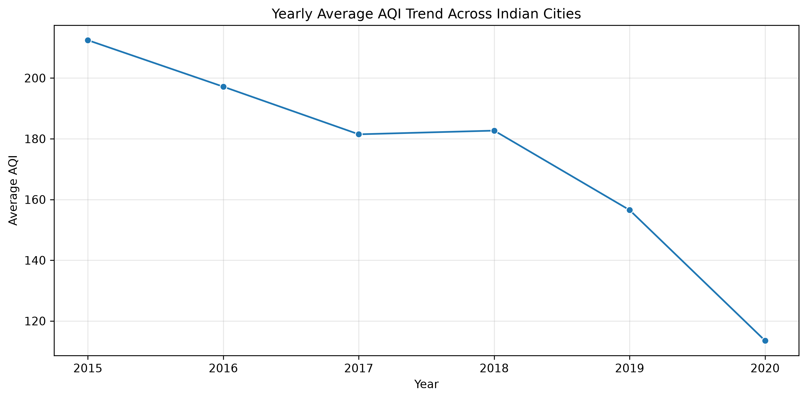
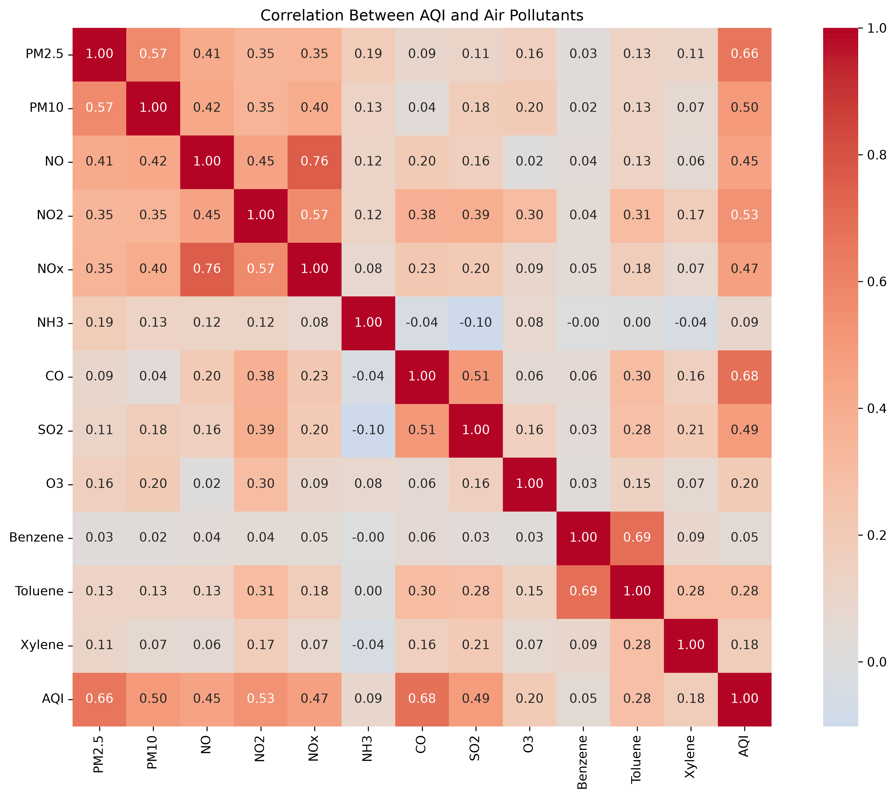
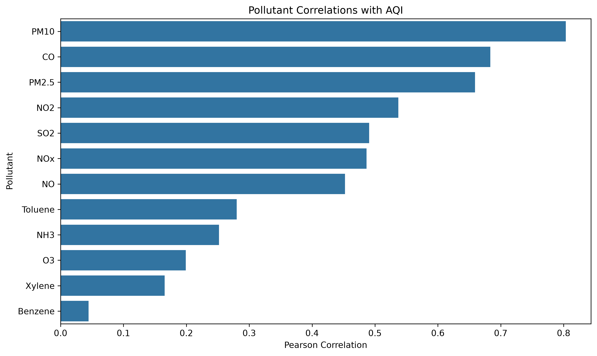

# 🇮🇳 India Air Quality & Pollution Analysis

<p align="center">
  <strong>Exploratory Data Analysis · Environmental Data Science · Statistical Analysis</strong>
</p>

<p align="center">
  An end-to-end data analysis project investigating historical air quality across Indian cities, uncovering pollution patterns, seasonal variation, data quality challenges, and relationships between measured pollutants and the Air Quality Index (AQI).
</p>

<p align="center">
  
  
  
  
  
  
  
  
</p>

<p align="center">
  <a href="https://github.com/Ashokreddy45/india-air-pollution-analysis">Repository</a> ·
  <a href="https://github.com/Ashokreddy45/india-air-pollution-analysis/tree/main/notebooks">Explore Notebooks</a> ·
  <a href="https://github.com/Ashokreddy45/india-air-pollution-analysis/tree/main/outputs/figures">View Visualizations</a> ·
  <a href="https://github.com/Ashokreddy45/india-air-pollution-analysis/tree/main/reports">Read the Report</a>
</p>

---

## 📌 Project Overview

Air pollution is an important environmental and public-health challenge. Understanding how air quality varies across locations and over time can help identify patterns, investigate potential pollution hotspots, and support further environmental research.

This project analyzes historical air quality observations from Indian cities using Python and data analysis libraries. It follows a structured workflow, beginning with data auditing and cleaning and progressing through exploratory analysis, temporal trends, city-level comparisons, and pollutant–AQI associations.

Rather than relying on a single visualization, the project combines data-quality assessment, statistical summaries, visual exploration, and exported analytical results.

### Project at a glance

| Attribute | Details |
|---|---|
| Project type | Exploratory Data Analysis (EDA) |
| Domain | Environmental Data Science |
| Geographic scope | Multiple Indian cities |
| Historical period | 2015–2020, with 2020 observations ending in July |
| Original dataset size | 29,531 rows × 16 columns |
| AQI observations available | 24,850 |
| Analysis environment | Python 3.12 and Jupyter Notebook |
| Main deliverables | Four notebooks, visualizations, CSV outputs, and a written report |

## 🎯 Objectives

- Audit the dataset for missing values, duplicate records, and coverage gaps.
- Clean and prepare pollutant measurements for exploratory analysis.
- Examine the distribution and variability of the Air Quality Index.
- Compare observed AQI levels across cities while considering data coverage.
- Investigate monthly, seasonal, and yearly patterns.
- Explore statistical associations between pollutant measurements and AQI.
- Generate reproducible tables and visualizations.
- Document methodological limitations and opportunities for further analysis.

## 🧰 Technology Stack

<table>
  <thead>
    <tr>
      <th>Technology</th>
      <th>Role in the Project</th>
    </tr>
  </thead>
  <tbody>
    <tr><td><strong>Python</strong></td><td>Core programming language for the analysis workflow.</td></tr>
    <tr><td><strong>pandas</strong></td><td>CSV ingestion, data cleaning, missing-value analysis, grouping, aggregation, and time-based analysis.</td></tr>
    <tr><td><strong>NumPy</strong></td><td>Numerical operations and support for analytical calculations.</td></tr>
    <tr><td><strong>Matplotlib</strong></td><td>Chart creation, figure formatting, and export of visualizations.</td></tr>
    <tr><td><strong>Seaborn</strong></td><td>Statistical visualizations and correlation heatmaps.</td></tr>
    <tr><td><strong>SciPy</strong></td><td>Statistical tools, including correlation analysis support.</td></tr>
    <tr><td><strong>Jupyter Notebook</strong></td><td>Interactive, documented, and step-by-step analytical workflow.</td></tr>
    <tr><td><strong>Git and GitHub</strong></td><td>Version control, source-code hosting, and project documentation.</td></tr>
    <tr><td><strong>VS Code</strong></td><td>Development environment used to manage and execute the notebooks.</td></tr>
  </tbody>
</table>

## 📊 Dataset Overview

The analysis uses a daily city-level air-quality dataset containing measurements of multiple air pollutants and an Air Quality Index (AQI).

### Dataset dimensions

- **29,531 observations**
- **16 columns**
- **26 cities**
- Historical dates from January 2015 through July 2020

### Important variables

| Variable | Description |
|---|---|
| `City` | City associated with the observation |
| `Date` | Observation date |
| `PM2.5` | Fine particulate matter concentration |
| `PM10` | Coarse particulate matter concentration |
| `NO` | Nitric oxide measurement |
| `NO2` | Nitrogen dioxide measurement |
| `NOx` | Nitrogen oxides measurement |
| `NH3` | Ammonia measurement |
| `CO` | Carbon monoxide measurement |
| `SO2` | Sulfur dioxide measurement |
| `O3` | Ozone measurement |
| `Benzene` | Benzene measurement |
| `Toluene` | Toluene measurement |
| `Xylene` | Xylene measurement |
| `AQI` | Air Quality Index value |
| `AQI_Bucket` | Source-provided AQI category |

The dataset contains substantial missingness in several pollutant variables and in AQI. These gaps are assessed before interpretation because incomplete observations can influence comparisons and statistical results.

**Dataset source:** Add the original dataset provider and its URL here before publishing the final repository. The raw CSV is intentionally excluded from version control; see the setup instructions below.

## 🔬 Analytical Workflow

The project is organized into four notebooks, each with a distinct purpose.

### 01 — Data Audit

File: [`01_data_audit.ipynb`](notebooks/01_data_audit.ipynb)

- Load the raw dataset and inspect its dimensions and schema.
- Examine data types and missing-value counts.
- Check duplicate rows and city–date combinations.
- Assess city coverage and AQI completeness.
- Compare AQI missingness across years and cities.
- Export data-quality audit tables.

### 02 — Data Cleaning

File: [`02_data_cleaning.ipynb`](notebooks/02_data_cleaning.ipynb)

- Parse dates and prepare a working copy of the data.
- Impute missing pollutant measurements using city-level medians, with a global-median fallback.
- Preserve missing AQI and AQI category values rather than inventing target values.
- Export the cleaned dataset and cleaning audit tables.
- Generate a visualization of missingness before cleaning.

**Methodological note:** Median imputation is a practical preprocessing choice, not a guarantee of unbiased estimates. Analyses of original pollutant–AQI relationships should use observed measurements rather than treating imputed values as genuine observations.

### 03 — Exploratory Data Analysis

File: [`03_exploratory_data_analysis.ipynb`](notebooks/03_exploratory_data_analysis.ipynb)

- Analyze AQI distributions and descriptive statistics.
- Compare average AQI across cities.
- Explore annual, monthly, and seasonal patterns.
- Examine relationships among pollutant variables.
- Create visual summaries and export supporting tables.

### 04 — Advanced Analysis

File: [`04_advanced_analysis.ipynb`](notebooks/04_advanced_analysis.ipynb)

- Assess city-level AQI availability and completeness.
- Compare cities by observed average AQI.
- Investigate seasonal and monthly AQI variation.
- Examine yearly AQI trends for selected cities.
- Calculate Pearson and Spearman correlations between observed pollutant measurements and AQI using the raw dataset.
- Export consolidated analytical findings.

The notebook separates observed-pair correlation analysis from the imputed dataset to reduce the risk of presenting imputation-driven relationships as measured evidence.

## 📈 Key Findings

The following results are based on the current analysis outputs.

### Overall AQI statistics

| Metric | Observed result |
|---|---:|
| Total dataset records | 29,531 |
| Records with available AQI | 24,850 |
| Records with missing AQI | 4,681 |
| Mean observed AQI | 166.46 |
| Median observed AQI | 118 |
| Standard deviation of AQI | 140.70 |
| Highest observed AQI | 2,049 |
| Records with AQI above 500 | 543 |

### Initial observations

- **AQI availability is incomplete:** 4,681 records do not have an AQI value, so analyses that depend on AQI use fewer observations than the full dataset.
- **The AQI distribution is highly variable:** the mean of 166.46 is above the median of 118, indicating that high observations influence the overall average.
- **Extreme AQI values deserve investigation:** 543 observations exceed 500. These should be retained for descriptive analysis unless a documented data-quality rule justifies treating any record differently.
- **City-level comparisons need context:** Ahmedabad has the highest average AQI in the current summary at approximately 452.12, while Aizawl has the lowest at approximately 34.77. These are observed dataset averages, not definitive rankings of present-day city air quality. Coverage, observation periods, and missingness can affect the comparison.
- **Historical trends require careful interpretation:** the dataset ends in July 2020, so the final year is incomplete and should not be compared with full calendar years without qualification.

These results are descriptive, not causal. They characterize the available historical records and should not be interpreted as current air-quality measurements.

## 🖼️ Visualizations

The repository contains exported figures for reviewing the analysis without running the notebooks.

### AQI distribution



Examines the distribution and variability of observed AQI values.

### City-level AQI comparison



Compares observed city-level average AQI. Interpret the ranking alongside the corresponding observation counts and coverage.

### Seasonal patterns



Explores AQI differences across the calendar-based seasonal groups used in the analysis.

### Monthly patterns



Examines how average AQI varies by month.

### Yearly trends



Shows historical AQI trends in the analysis output. The final year contains observations only through July 2020.

### Pollutant relationships



Visualizes correlations among pollutant variables.

### Pollutant–AQI correlations



Summarizes pollutant–AQI associations calculated from observed paired values. Correlation does not establish causation, and AQI is itself derived from pollutant measurements.

### Additional figures

More charts are available in [`outputs/figures/`](outputs/figures/), including:

- Highest and lowest city AQI comparison
- Missing values before cleaning
- Advanced monthly AQI analysis
- Advanced seasonal AQI analysis
- Selected-city yearly AQI analysis

## 🗂️ Repository Structure

```text
india-air-pollution-analysis/
│
├── data/
│   ├── raw/
│   │   └── archive-3/
│   │       └── city_day.csv          # Download separately; not tracked by Git
│   └── processed/
│       └── city_day_cleaned.csv      # Generated by the cleaning notebook
│
├── notebooks/
│   ├── 01_data_audit.ipynb
│   ├── 02_data_cleaning.ipynb
│   ├── 03_exploratory_data_analysis.ipynb
│   └── 04_advanced_analysis.ipynb
│
├── outputs/
│   ├── figures/                      # Exported charts
│   └── tables/                       # CSV analysis outputs
│
├── reports/
│   └── india_air_pollution_analysis.md
│
├── sql/                              # Reserved for optional SQL extensions
├── src/                              # Reserved for reusable Python modules
├── .gitignore
├── data_audit_initial.txt
├── requirements.txt
└── README.md
```

The `data/processed/`, `sql/`, and `src/` directories may contain generated or reserved project areas. The primary implemented workflow is currently notebook-based.

## ⚙️ Getting Started

Follow these steps to reproduce the analysis locally.

### Prerequisites

- Python 3.12 or a compatible Python 3 version
- Git
- Visual Studio Code or Jupyter Notebook
- The original dataset CSV

### 1. Clone the repository

```bash
git clone https://github.com/Ashokreddy45/india-air-pollution-analysis.git
cd india-air-pollution-analysis
```

### 2. Create and activate a virtual environment

macOS/Linux:

```bash
python3 -m venv .venv
source .venv/bin/activate
```

Windows:

```powershell
python -m venv .venv
.venv\Scripts\activate
```

### 3. Install dependencies

```bash
python -m pip install --upgrade pip
python -m pip install -r requirements.txt
```

### 4. Download the dataset

Download the original dataset from its provider and place `city_day.csv` at:

```text
data/raw/archive-3/city_day.csv
```

Do not rename the file unless you also update the input path in the notebooks.

### 5. Open the project

```bash
code .
```

Alternatively, open the folder directly in VS Code, select the `.venv` Python interpreter, and use the Jupyter extension to open the notebooks.

### 6. Run the notebooks in order

Execute each notebook from top to bottom:

1. `01_data_audit.ipynb`
2. `02_data_cleaning.ipynb`
3. `03_exploratory_data_analysis.ipynb`
4. `04_advanced_analysis.ipynb`

The cleaning and analysis notebooks generate processed data, CSV tables, and figures in the project directories. Run the earlier notebooks first so that their required files exist.

## 🧪 Reproducibility and Data Quality

The workflow includes several practices intended to make the analysis easier to inspect and reproduce:

- Separate raw and processed data locations.
- A dedicated data-audit notebook before cleaning.
- Exported CSV tables for important intermediate and final results.
- Saved figures for use in reports and portfolio presentations.
- Correlation calculations based on observed raw measurements in the advanced notebook.
- A dependency list in `requirements.txt`.
- Git version control and a `.gitignore` file.

The notebooks are the primary implementation. The `src/` and `sql/` directories are included as organizational foundations for future extensions, not as claims that a separate Python package or SQL pipeline has already been implemented.

## ⚠️ Limitations

A reliable analysis should make its limitations explicit.

1. **Missing data:** Several pollutant variables and AQI contain missing values. The amount of missingness varies across cities and time.
2. **Imputation:** City-median imputation can reduce the variability of pollutant measurements and influence distributions or correlations. Imputed values should not be treated as direct observations.
3. **Unequal city coverage:** Cities have different observation counts and periods. Simple average comparisons may not be fully comparable.
4. **Extreme observations:** Some AQI values are exceptionally high. They require contextual and data-quality investigation rather than automatic deletion.
5. **Historical scope:** The dataset ends in July 2020 and does not describe current air quality.
6. **Seasonal definitions:** Calendar-based seasonal groups are simplified and may not reflect the local meteorological conditions of every city.
7. **Correlation versus causation:** Associations between pollutants and AQI cannot establish causal effects. AQI is derived from pollutant measurements, so these relationships are not independent evidence of causality.
8. **No forecasting claims:** This project focuses on descriptive and exploratory analysis; it does not currently present a validated predictive model.

## 🚀 Future Improvements

Potential extensions include:

- Build an interactive dashboard using Streamlit or Plotly Dash.
- Add city comparisons restricted to common observation periods.
- Investigate the sensitivity of results to missing-data handling.
- Add uncertainty estimates and sample-size annotations to city comparisons.
- Use SQL for analytical queries and structured reporting.
- Develop a reusable Python package for loading, validating, and transforming the dataset.
- Explore time-series forecasting only after defining an appropriate target, baseline, and time-based validation strategy.
- Integrate newer, properly sourced observations for a separate current-air-quality analysis.

These are proposed extensions and are not represented as completed features.

## 💡 Skills Demonstrated

- Python programming for data analysis
- Data ingestion and transformation with pandas
- Numerical computing with NumPy
- Data-quality assessment and missing-value analysis
- Exploratory Data Analysis (EDA)
- Descriptive statistics and correlation analysis
- Time-based grouping and trend visualization
- Statistical plotting with Matplotlib and Seaborn
- Reproducible Jupyter Notebook workflows
- Exporting analysis outputs and documenting limitations
- Git and GitHub version control

## 👨‍💻 Author

**Ashok Reddy Damireddy**

Computer Science Engineering — Data Science

Interested in Data Science, Data Engineering, Machine Learning, and AI.

- GitHub: [@Ashokreddy45](https://github.com/Ashokreddy45)
- Project repository: [India Air Pollution Analysis](https://github.com/Ashokreddy45/india-air-pollution-analysis)

## 📄 License

No license has been specified for this repository yet. Before publishing or inviting reuse, add an appropriate license and verify the dataset's own redistribution and attribution terms.

---

<p align="center">
  <sub>Built with Python, data analysis, and a focus on reproducible environmental insights.</sub>
</p>
